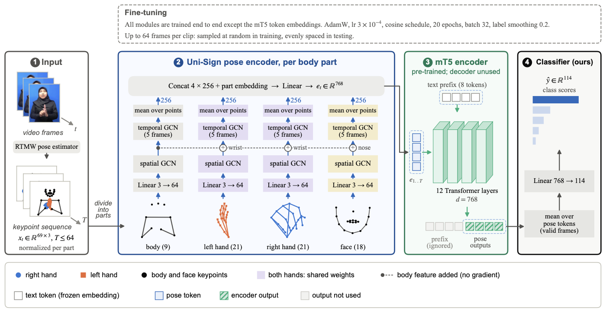

<div align="center">

# Signer-Independent SIBI Recognition: A Benchmark of Skeleton and Pretrained Models

Muhamad Syukron, Raden Ajeng Aninditha Tazkia Ariniputri, Danish Rafie Ekaputra

[](#citation)
[](https://huggingface.co/0xRafie/uni-sign-sibi)
[](LICENSE)

</div>



<sub>Uni-Sign (pose) as fine-tuned here. Video frames from the online SIBI dictionary.</sub>

Code for a signer-independent benchmark of isolated sign recognition for SIBI (Sistem Isyarat Bahasa Indonesia), the
signed form of Indonesian taught in Indonesian schools for deaf students. The benchmark covers 114 classes in four
categories (18 affixes, 41 numbers, 26 letters, and 29 words) recorded by 22 signers. It compares five models under two
protocols (figure above, one example fold each):

- **SD (signer-dependent):** stratified 5-fold cross-validation over clips, the protocol of earlier SIBI work.
- **SI (signer-independent):** leave-one-signer-out cross-validation over 22 folds, so every test signer is unseen.

## Results

Accuracy (%) under SI: per instance (P-I), and per class (P-C) for Overall. The BiLSTM under SD is shown for reference.

| Input | Model | Protocol | Affix | Number | Alphabet | Word | Overall P-I | Overall P-C |
|---|---|---|---|---|---|---|---|---|
| MediaPipe | BiLSTM (Ho and Santoso) | SD | 95.92 | 99.44 | 98.73 | 98.89 | 97.29 | 97.34 |
| MediaPipe | BiLSTM (Ho and Santoso) | SI | 83.70 | 95.13 | 90.59 | 95.92 | 85.72 | 86.09 |
| MediaPipe | SignBart | SI | 86.16 | 91.64 | 95.71 | 97.16 | 86.68 | 87.17 |
| RTMW | DSTA-SLR | SI | 83.48 | 97.32 | 90.44 | 99.07 | 88.57 | 89.29 |
| RTMW | Uni-Sign (pose) | SI | **93.56** | 96.98 | **96.36** | 99.25 | **95.16** | **95.40** |
| DINOv2 + MediaPipe | SHuBERT | SI | 84.52 | 80.37 | 86.42 | **99.42** | 83.10 | 84.27 |

Category columns use the within-category score. Overall uses the 114-class score.

## Installation

```bash
git clone https://github.com/0xRafie/sibi-islr-benchmark && cd sibi-islr-benchmark
conda env create -f environment.yml && conda activate sibi-islr      # Python 3.12
# or, in any Python 3.10-3.12 environment:
pip install -e ".[dev]"
```

The core install (keypoint extraction with MediaPipe, preprocessing, BiLSTM, SignBart, DSTA-SLR, evaluation, figures)
pins the versions of the paper runs; MediaPipe must stay at 0.10.14, the version the BiLSTM baseline was built on. The
other models need extras, e.g. `pip install -e ".[rtmw,unisign]"`:

| Extra | For | Notes |
|---|---|---|
| `rtmw` | RTMW keypoints (`prepare_data.py extract-rtmw`) | rtmlib + `onnxruntime-gpu`, one NVIDIA GPU |
| `unisign` | Uni-Sign (pose) | transformers 4.40.0; the Uni-Sign code is cloned at run time at the pinned commit |
| `shubert` | SHuBERT stage a | stage b and the LoRA runs use the authors' fairseq environment (Python 3.10), see `sibi_islr/models/shubert.py` |

Training uses one NVIDIA GPU (all reported runs used a Tesla T4). SignBart, DSTA-SLR, Uni-Sign, and SHuBERT are loaded
from their authors' repositories at the commits used in the paper (see the module docstrings).

## Data

The SIBI dataset of Darmawan et al. is available from its owner under a data use agreement for non-commercial research.
This repository contains **no** videos, images, keypoints, fold files, or predictions. The fold files are regenerated
from the dataset with `python prepare_data.py folds`. Please cite the dataset articles required by the agreement.

Two lists are released, with file names and frame numbers only:

- `lists/clips.csv`: the 22,671 clips used after cleaning (106 removed): `clip` (path without extension), `category`
  (affix, number, alphabet, word), `class`, `signer`, `take`.
- `lists/word_boundaries.csv`: where each of the 4,507 word clips lies in its neutral sentence video (1,099 of the 1,100
  videos; `subject-4-sentence-7-neutral-rep-1` is left out). `frame_start` and `frame_end` are 0-based frame indices at
  30 fps, and the word spans `[frame_start, frame_end)`. `token_index` is the position of the word in the sentence's
  sign sequence. `source` is `manual` for boundaries corrected by an annotator and `forced_alignment` otherwise.

Three inputs derived from the dataset are not included and are available from the authors once the data owner has granted
access:
- the manual sign boundaries of the 110 annotated sentence videos used to train the aligner;
- the corrected labels of one signer's sentence files;
- the fold files.

Paths default to `data/` (dataset and keypoints), `qc/` (inventories, folds, runs, results) and `paper/` (generated
tables and Fig. 1-5), relative to the working directory, and to the working directory for the SIBI dictionary clips.
Every entry point takes `--data-dir`, `--qc-dir`, `--paper-dir` and `--dict-dir`, which override the environment
variables `SIBI_DATA`, `SIBI_QC`, `SIBI_PAPER` and `SIBI_DICT` (see [`sibi_islr/config.py`](sibi_islr/config.py)).
Uni-Sign, SHuBERT and the linear heads read their fold tables from `./qc` (or the working directory), so run them from
the folder that holds `qc/`.

## Model Zoo

| Model | Trained on | Expected accuracy on a new signer | License | Download |
|---|---|---|---|---|
| Uni-Sign (pose), 114 classes | all 22 signers, no test split | the SI row above (Overall P-I 95.16%) | CC BY-NC 4.0 | [0xRafie/uni-sign-sibi](https://huggingface.co/0xRafie/uni-sign-sibi) |

```bash
hf download 0xRafie/uni-sign-sibi --local-dir weights/uni-sign-sibi   # sibi_pose_only_islr.pth, classes.json
```

## Quick start

No dataset is needed for the self-checks: every step with a `--demo` runs it on synthetic data on a CPU.

```bash
pytest                                   # configs, released lists, AST equivalence, and the --demo self-checks
python prepare_data.py folds --demo
python train.py --model bilstm --demo
python evaluate.py analyze --demo
python make_figures.py --demo
```

The entry points hand their remaining arguments to the module of the step, whose docstring documents them
(`python prepare_data.py --help` lists the steps):

| Entry point | Steps |
|---|---|
| `prepare_data.py STEP` | `inventory`, `extract` (MediaPipe), `extract-rtmw`, `trim`, `pack`, `segment`, `align`, `fplus`, `cut`, `folds`, `unisign-features`, `shubert-features` |
| `train.py --model M` | `bilstm`, `signbart`, `dsta_slr`, `unisign`, `shubert`; exploratory: `replication`, `input-variants`, `heads`, `harness`. `--protocol sd\|si\|all`, `--config configs/M.yaml` |
| `evaluate.py STEP` | `analyze` (metrics, Wilcoxon signed-rank tests with Holm correction), `tables`, `protocol-counts` |
| `make_figures.py` | Fig. 1-5 and Table II; `final`: Fig. 6-7 |
| `explain.py STEP` | `run` (test-time occlusion of Uni-Sign), `occlusion` |

## Reproducing the paper

```bash
scripts/reproduce_all.sh      # every step below, in order (dataset and GPUs needed)
```

| Paper item | Script | GPU | Output |
|---|---|---|---|
| Keypoints, word clips, folds | `scripts/prepare_data.sh` | RTMW and the word aligner | `data/pilot/*.npz`, `qc/folds_combined.csv` |
| Table I: dataset statistics (typed from the counts) | `scripts/table1_dataset.sh` | no | `qc/protocol_counts.csv` |
| Table III: BiLSTM, SD and SI | `scripts/train_bilstm.sh` (`PROTOCOL=sd` for SD) | yes (T4), 5 seeds per fold | `qc/final/bilstm_*` |
| Table III: SignBart | `scripts/train_signbart.sh` | yes (T4), 22 folds | `qc/final/signbart` |
| Table III: DSTA-SLR | `scripts/train_dsta_slr.sh` | yes (T4, CUDA only), 22 folds | `qc/final/dsta_slr` |
| Table III: Uni-Sign (pose) | `scripts/train_unisign.sh` | yes (T4), 22 folds | `qc/final/unisign` |
| Table III: SHuBERT | `scripts/train_shubert.sh` | yes (T4), 22 folds | `qc/final/shubert` |
| Table III: metrics, tests, LaTeX table | `scripts/table3_results.sh` | no | `qc/results/final_*.csv`, `paper/table_results.tex` |
| Table IV: Uni-Sign input ablation | `scripts/table4_ablation.sh` | yes for the 3 variants (`SKIP_TRAIN=1`: analysis only) | `qc/results/final_ablasi_*.csv`, `paper/table_ablation.tex` |
| Fig. 1-5, Table II (keypoints) | `scripts/figures_1_to_5.sh` | no | `paper/figures/`, `paper/table_keypoints.tex` |
| Fig. 6 (per-signer accuracy), Fig. 7 (affix confusion) | `scripts/figures_6_7.sh` | no | `qc/figures/` |
| Released model | `scripts/train_unisign_release.sh` | yes (T4, about 4.3 hours) | `weights/unisign_release/` |
| Occlusion analysis of Uni-Sign (beyond the tables) | `scripts/explain_occlusion.sh` | yes | `qc/explain/` |

Each script states its data and GPU needs in its header. The settings of the paper runs (seeds, epochs, learning rates,
batch sizes, schedules) are recorded in [`configs/`](configs), one YAML file per model; `tests/test_configs.py` checks
that every value equals the code. `train.py` loads `configs/<model>.yaml` and writes values that differ into the recipe
dictionaries of the code, so the shipped files reproduce the paper and an edited copy changes a recipe without code
changes.

## Released model

A Uni-Sign (pose) model fine-tuned on all 22 signers is released on Hugging Face at
[0xRafie/uni-sign-sibi](https://huggingface.co/0xRafie/uni-sign-sibi) under CC BY-NC 4.0. That is the license of the
Uni-Sign weights it starts from, and it matches the non-commercial terms of the data. Its expected accuracy on a new signer
is the SI result above.

`sibi_pose_only_islr.pth` holds the Uni-Sign pose encoder, the mT5 encoder and a 114-class linear head (the `FineTune`
module of [`sibi_islr/training/unisign.py`](sibi_islr/training/unisign.py)); `classes.json` gives the output index,
category and class name of each class. The input is 69 of the 133 RTMW whole-body keypoints per frame
(`prepare_data.py extract-rtmw`). The repository has no `predict.py`: running the model on new videos needs the pinned
Uni-Sign code, the RTMW extraction and the mT5 tokenizer, and that path has not been tested end to end outside the
training code.

## Repository layout

```
prepare_data.py, train.py, evaluate.py, make_figures.py, explain.py   entry points
configs/        settings of the paper runs, one YAML per model (+ data.yaml)
scripts/        one shell script per paper table or figure, prepare_data.sh, reproduce_all.sh
lists/          clips.csv, word_boundaries.csv
assets/         overview figure
sibi_islr/
  config.py     paths (command line > SIBI_* > defaults) and YAML loading
  data/         inventory, extract_mediapipe, extract_rtmw, trim, pack, features (F0 input), folds,
                words/ (segment, align, fplus, cut)
  models/       bilstm (with the replication check), signbart, dsta_slr + dsta_slr_network, unisign, shubert, common
  training/     common (protocols, splits, metrics), bilstm + bilstm_inputs, slot2 + slot2_inputs (SignBart,
                DSTA-SLR), unisign, shubert, heads, harness
  evaluation/   metrics, stats (Wilcoxon, Holm, Friedman/Nemenyi), analyze, protocol_counts, tables
  figures/      common, results (Fig. 4, 6, 7), keypoints (Fig. 1, 2, Table II), unisign (Fig. 3, 5), make
  explain/      occlusion, run
tests/          configs, lists, AST equivalence with the former scripts, --demo self-checks
```

The code was restructured from flat scripts without changing any computation; `tests/test_equivalence.py` compares
every function, class and constant with the former `scripts/` folder (set `SIBI_REFERENCE_SCRIPTS` to it). Docstrings
and comments still use the former script names in places: `inventory_darmawan` = `data/inventory`, `extract` =
`data/extract_mediapipe`, `pack_mp` = `data/pack`, `gate` = `models/bilstm`, `gate_variants` = `data/features`,
`segment_words`, `align_words`, `seg_fplus`, `cut_words` = `data/words/{segment,align,fplus,cut}`, `train_main` =
`training/{common,bilstm_inputs,bilstm}`, `slot2` = `training/{slot2_inputs,slot2}`, `train_slot2` = `training/harness`,
`train_heads` = `training/heads`, `unisign_features` = `models/unisign`, `unisign_finetune` = `training/unisign`,
`shubert_features` = `models/shubert`, `shubert_lora` = `training/shubert`, `analyze` =
`evaluation/{metrics,stats,analyze}`, `paper_tables` = `evaluation/tables`, `figures` = `figures/`,
`explain_unisign(_run)` = `explain/{occlusion,run}`.

## Citation

The paper is under review. A citation will be added here once it is published.

## License

- The code in this repository is released under the MIT License ([`LICENSE`](LICENSE)).
- `sibi_islr/models/dsta_slr.py` and `sibi_islr/models/dsta_slr_network.py` are adapted from DSTA-SLR and stay under
  CC BY-NC 4.0.
- SignBart, Uni-Sign, and SHuBERT are used from their own repositories under their own terms.
- The released Uni-Sign (pose) weights are under CC BY-NC 4.0.

See [`NOTICE.md`](NOTICE.md) for details.
